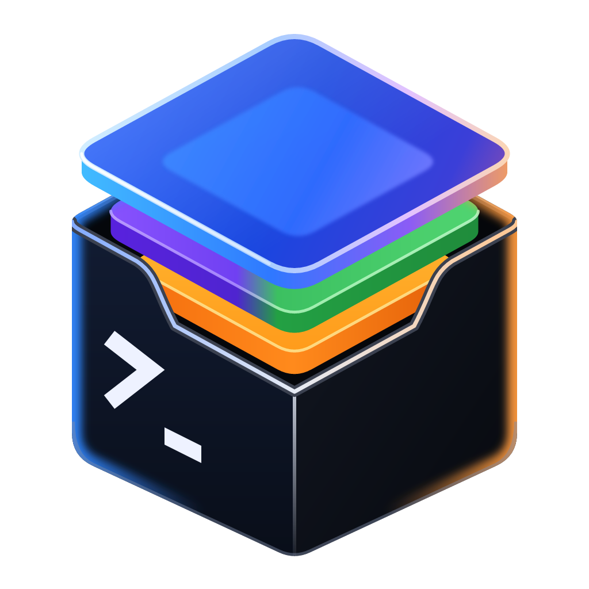
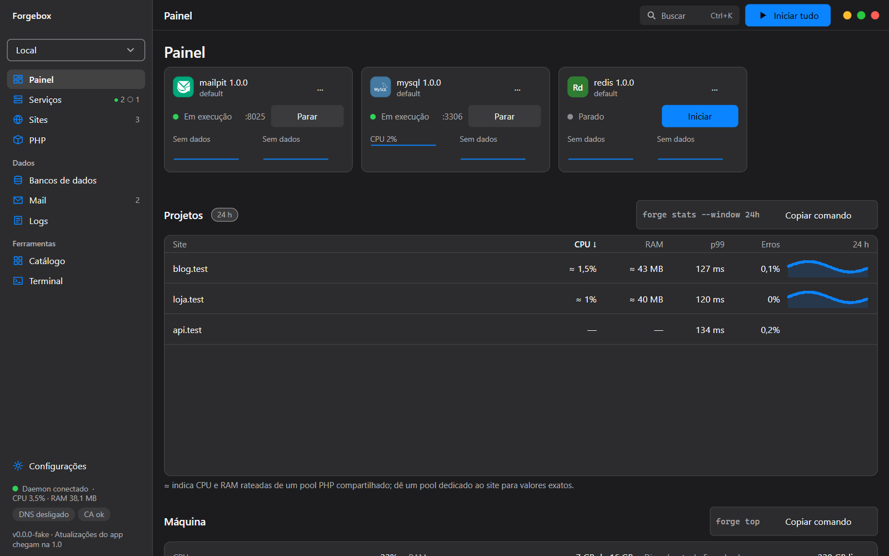
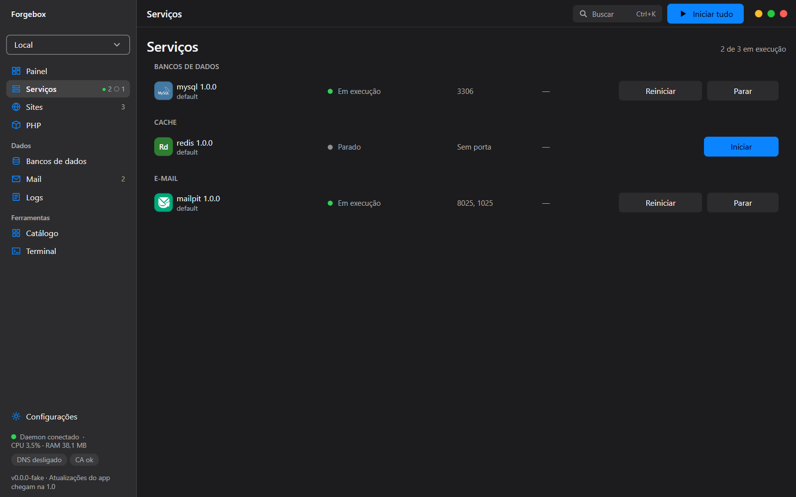
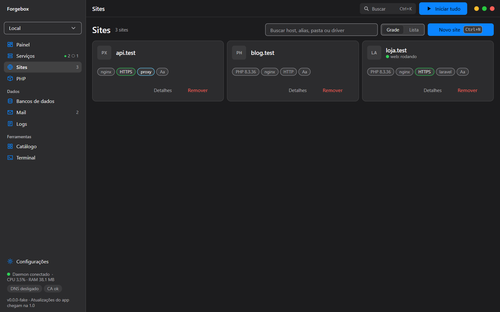
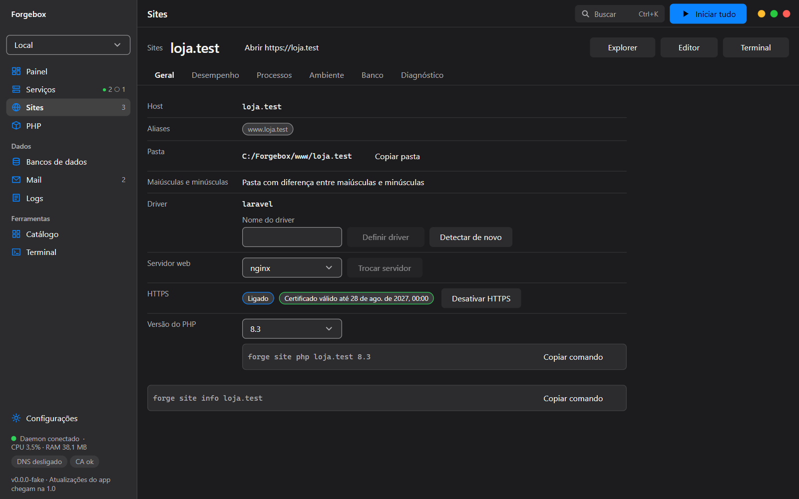
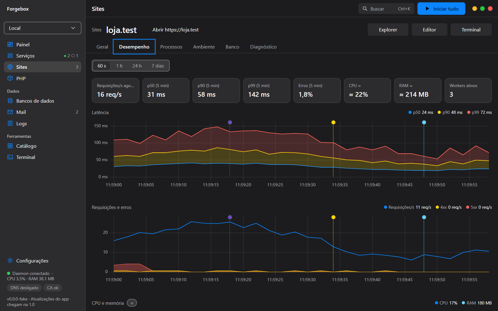
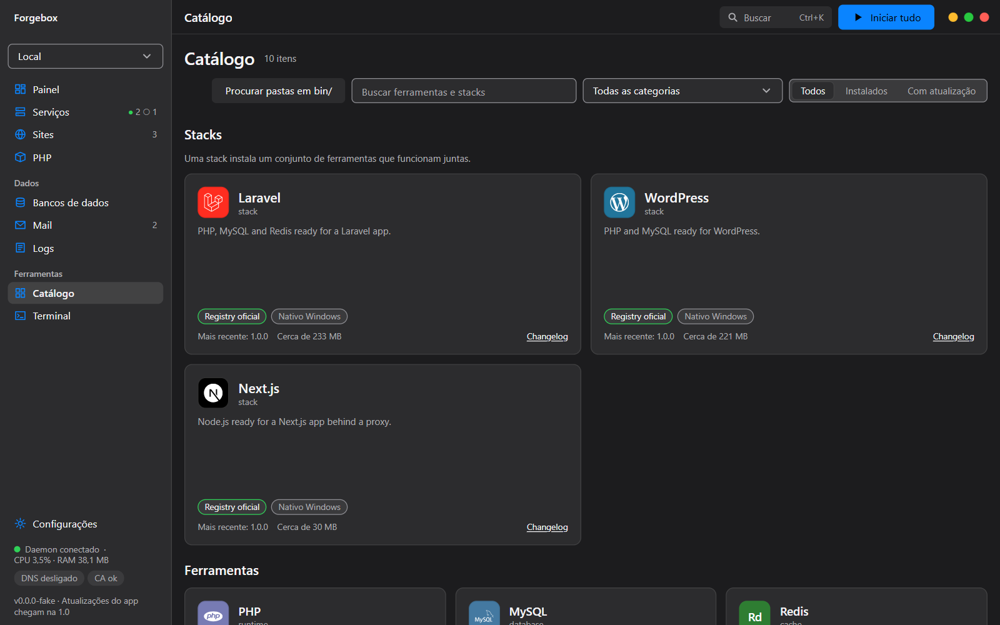
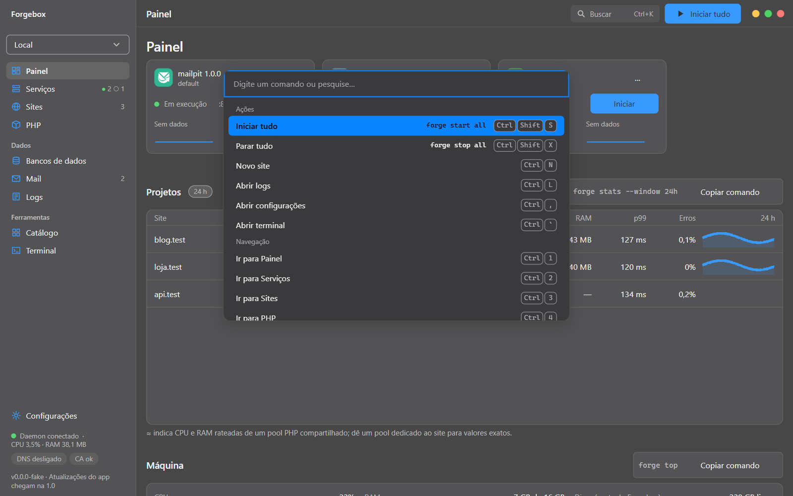
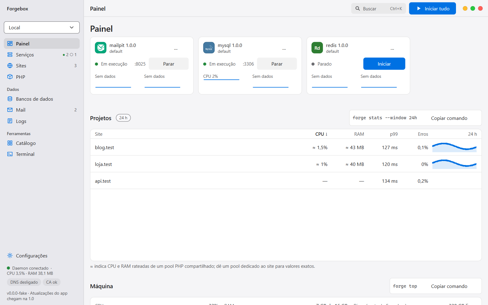

# Forgebox

<p align="center">
  
</p>

<p align="center">
  
</p>

**A stack local inteira, sob controle total, com um clique.**

Ambiente de desenvolvimento local para Windows (PHP, Node, bancos, cache, mail, túneis) escrito em Rust: motor pequeno e determinístico, múltiplas versões de tudo rodando ao mesmo tempo (cada vhost escolhe seu PHP), catálogo aberto de ferramentas em YAML com instalação sob demanda e auto-update, DNS `*.test` e HTTPS locais de verdade, e uma interface com acabamento de app Apple.

Pensado para superar Laragon, Laravel Herd, ServBay, XAMPP e WampServer em função, controle e UI/UX.

## Status
Versão em desenvolvimento rumo à 0.2.0. O **M1 (motor headless + CLI)** está entregue: manifestos YAML e registry assinado, downloads verificados (sha256), instalação multi-versão (`bin/<tool>/<versão>` + junction `current`), supervisor de serviços e pools PHP por vhost, sites com nginx/Apache/Caddy, DNS `*.test` e HTTPS locais, o daemon `forgeboxd` com API remote-ready e o CLI `forge`. O **M2 (interface)** entrega o app `Forgebox.exe` (Tauri 2 + React 19): painel, serviços, sites (com PHP por vhost e desempenho por site), PHP, bancos, mail, logs, catálogo, terminal, configurações e diagnóstico, paleta de comandos, bandeja do sistema e notificações. O gate final do M2 (checklist humana) foi adiado e será tratado em versões de patch. Detalhes em [`docs/STATUS.md`](docs/STATUS.md) e no [roadmap](docs/10-roadmap-and-agent-tasks.md).

## Capturas de tela

Capturas do app real (build de QA com dados de exemplo dos cenários de teste), tema escuro e uma no claro. Para regerar: `pnpm -C apps/desktop qa:readme-shots`.


*Painel: serviços, sites e atividade num relance.*  
*Dashboard (Painel): services, sites and activity at a glance.*



*Serviços: várias versões de cada ferramenta, iniciar e parar com um clique.*  
*Services: several versions of each tool, start and stop in one click.*



*Sites: domínios locais com HTTPS e a versão de PHP de cada um.*  
*Sites: local domains with HTTPS and the PHP version of each one.*



*Detalhe do site: PHP por vhost, servidor web, certificado e processos.*  
*Site detail: per-vhost PHP, web server, certificate and processes.*



*Desempenho do site: latência, vazão, rotas e erros a partir do access log.*  
*Site performance: latency, throughput, routes and errors from the access log.*



*Catálogo: ferramentas em YAML instaladas sob demanda, com hash verificado.*  
*Catalog: YAML-described tools installed on demand, hash-verified.*



*Paleta de comandos (Ctrl+K): tudo o que a interface faz, pelo teclado.*  
*Command palette (Ctrl+K): everything the interface does, from the keyboard.*



*O mesmo Painel no tema claro.*  
*The same Dashboard in the light theme.*

## Documentação
- [Visão e análise competitiva](docs/00-vision.md)
- [Arquitetura](docs/01-architecture.md) · [Estrutura do repositório](docs/02-project-structure.md) · [Motor](docs/03-engine.md)
- [Manifesto YAML de tools](docs/04-tool-manifest-spec.md) · [Providers e auto-update](docs/05-providers-and-updates.md)
- [Sites, multi-PHP, proxy, DNS, SSL](docs/06-sites-vhosts-multi-php.md) · [Catálogo e compatibilidade](docs/12-stacks-compat.md)
- [UI/UX](docs/07-ui-ux.md) · [Layout do release](docs/08-release-layout.md) · [CLI](docs/09-cli.md) · [Segurança](docs/11-security.md)
- [Modo remoto](docs/13-remote-mode.md) · [Observabilidade por vhost](docs/14-observability-metrics.md) · [Paridade Linux / case-sensitive](docs/15-linux-parity-case-sensitivity.md)
- [ADRs](docs/adr/README.md)

## Licença
MIT (núcleo). Ferramentas de terceiros mantêm suas licenças.

## Desenvolvimento

Pré-requisitos: Windows 10 (1809+) x64. O `rust-toolchain.toml` instala a toolchain stable com `rustfmt` e `clippy`. Para `cargo deny`, instale com `cargo install cargo-deny`. Os binários Windows embutem o ícone da marca como recurso (`build.rs` do `forge`, `forgeboxd`, `forgebox-helper`, `forge-mcp`, `forgebox-ctrl` e o do Tauri no `Forgebox.exe`), compilado pelo `rc.exe` do **Windows SDK** — o mesmo SDK que a toolchain MSVC já usa (Build Tools do Visual Studio, carga "Desenvolvimento para desktop com C++"); sem ele o build falha com uma mensagem apontando para cá. O ícone e os da bandeja são gerados de [`docs/design/brand`](docs/design/brand/README.md) com `pnpm -C apps/desktop icons` (conferência: `icons:check`).

```
cargo build --workspace                                    # compila todos os crates e binários
cargo test --workspace                                     # testes unitários e de integração
cargo clippy --workspace --all-targets -- -D warnings      # lint, warnings são erro
cargo fmt --all -- --check                                 # formatação
cargo deny check                                           # licenças, advisories, bans e fontes
cargo xtask schema | gen-ts | lint-registry | registry-index # tarefas de desenvolvimento (placeholders até M0-E1-T2)
```

### Desktop (`apps/desktop`)

Requer Node 24 e pnpm 10 (`packageManager` no `package.json`). Rust continua compilando sem Node.

```
pnpm -C apps/desktop install --frozen-lockfile   # dependências
pnpm -C apps/desktop tauri dev                   # app com hot reload (Tauri CLI fixada)
pnpm -C apps/desktop dev:qa                      # UI no navegador com a ponte falsa (?scenario=populated)
pnpm -C apps/desktop typecheck | lint | test     # tsc, eslint + stylelint, vitest
pnpm -C apps/desktop e2e | qa:check | qa:shots   # Playwright (Edge), checklist de QA, matriz de capturas
pnpm -C apps/desktop qa:readme-shots             # regera docs/assets/screenshots (README)
pnpm -C apps/desktop tauri build                 # Forgebox.exe de release
```

### Espaço em disco (`target/`)

Cada worktree do workflow (`C:\apps_src\Forgebox-wt\E*`) compila no **seu próprio** `target/`. Já tentamos compartilhar `C:\apps_src\Forgebox\target` entre eles e não funciona: o cargo calcula o hash dos pacotes de caminho relativo à raiz do workspace, então crates de branches diferentes recebem o mesmo nome de artefato e um worktree acaba linkando o código do outro (e binários MSVC como `deps/xtask.exe` nem têm hash). Para o custo em disco ficar aceitável:

- `.cargo/config.toml` (repo) e `C:\apps_src\Forgebox-wt\.cargo\config.toml` definem `[profile.dev] incremental = false`, `debug = "line-tables-only"` e `debug = false` para dependências externas. Mantenha os dois iguais. Backtraces continuam com arquivo e linha; quem quiser incremental local usa `CARGO_INCREMENTAL=1`.
- **Workers/agentes:** não alterem esses profiles nem passem `RUSTFLAGS`/`--profile` custom, não rodem `cargo clean` fora do seu worktree, não matem processos de build de outros worktrees e não registrem tarefas agendadas ou serviços. Se o disco tiver menos de 10 GB livres, parem e reportem.
- `scripts/clean-target.ps1` (opcional; `-Register` cria a tarefa agendada "Forgebox target sweep" para o usuário atual) remove `incremental/`, artefatos sem escrita há 5 dias e, abaixo de 30 GB livres, os diretórios de profile inteiros de um `target/`. Log em `target/clean-target.log`.

Antes de começar uma tarefa, leia [CLAUDE.md](CLAUDE.md) e o [índice da documentação](docs/README.md). O estado das tarefas do roadmap fica em [docs/STATUS.md](docs/STATUS.md).
