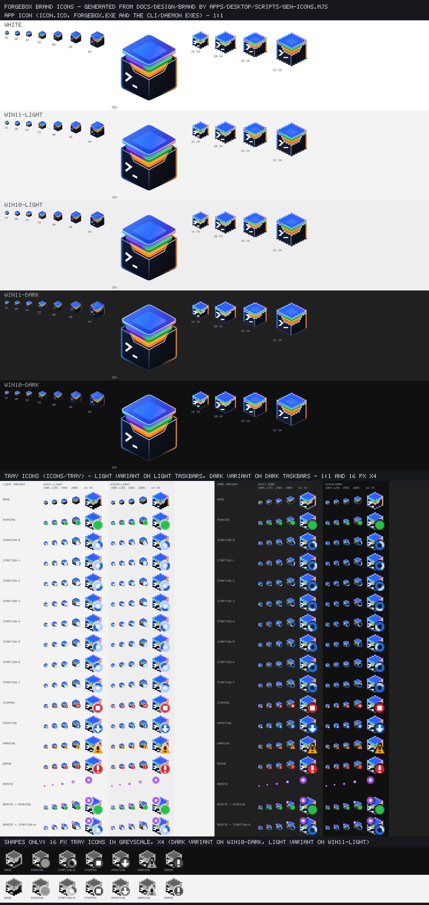

# Marca: ícone do app e ícones da bandeja

Fonte da verdade do visual: a arte de referência enviada pelo usuário,
[`reference-icon-tray.png`](reference-icon-tray.png) (mockup 1536×1024 sobre fundo escuro: o ícone
em 512→16 px, as seis variantes de estado da bandeja, a prévia na barra de tarefas e o menu da
bandeja que o M2-E1-T15 segue). Tudo nesta pasta é fonte; os arquivos em
`apps/desktop/src-tauri/icons/` são gerados a partir dela (M2-E1-T22).



## Intenção de design

- **Objeto:** uma caixa escura aberta (a "forja", com o prompt `>_` branco na face esquerda) que
  guarda camadas coloridas — roxo/verde e laranja — sob uma tampa de vidro azul flutuante. Lê-se
  como "stack local empilhada, sob controle, com terminal".
- **Luz:** aro azul à esquerda e laranja à direita (as luzes da referência), lábio metálico claro
  na borda recortada em U, aresta frontal clara. Sem brilho externo (glow) e com fundo
  transparente: o master não tem halo escuro nem claro sobre fundo branco, `#f3f3f3`, `#202020` ou
  as barras de tarefas do Windows 10 (verifique na folha de contato).
- **Tamanhos pequenos:** 16, 20, 24 e 32 px **não** são reduções do master (a reduzida de 16 px da
  referência fica borrada). São grades desenhadas pixel a pixel, alinhadas à grade 2:1, com menos
  camadas (16/20 px: só verde e laranja; tampa sem painel interno), prompt mais grosso (traços de
  2 px) e contorno por tema. 40, 48, 64 e 256 px vêm do master vetorial.
- **Bandeja:** o ícone pequeno + um selo no canto inferior direito (metade do ícone, anel de
  recorte transparente de 1 px para separar do ícone em qualquer barra). Cada estado tem **forma**
  própria — nunca só cor — e o teste de tons de cinza da folha de contato comprova isso.

## Estados da bandeja → selo

| Estado (arquivo) | Referência | Selo | Forma | Cor |
|---|---|---|---|---|
| `base` | — | nenhum (ícone puro) | — | — |
| `running` | Em execução | ponto cheio | disco | verde `#28c04c` |
| `starting-0` … `starting-7` | Iniciando | anel giratório (arco de 110° que avança 45° por quadro; ~8 fps só enquanto inicia, quadro estático com movimento reduzido) | anel vazado | azul (trilha clara + arco forte no tema claro; trilha azul + arco claro no escuro) |
| `stopped` | Parado | quadrado branco | disco + quadrado | vermelho `#e0262b` |
| `updating` | Atualizando | seta para baixo branca (com base a partir de 24 px) | disco + seta | azul `#1668f0` |
| `warning` | Atenção (algum serviço) | `!` escuro | **triângulo** + `!` | âmbar `#f5a00b` |
| `error` | Erro | `!` branco | disco + `!` | vermelho `#e0262b` |
| `remote` (sobreposição) | — (docs/13 §5) | ponto roxo com centro branco no canto **superior esquerdo**, com anel de 1 px na cor da barra do tema | disco pequeno | roxo `#a855f7` |

Divergência consciente da referência: lá, Atenção e Erro são ambos um `!` em disco (laranja vs.
vermelho), o que só difere por cor. Aqui Atenção usa o triângulo de alerta do Windows, com `!`
escuro (contraste melhor que branco sobre âmbar). A precedência entre estados (qual selo vence) é
do M2-E1-T15 e fica em [docs/07 §7](../../07-ui-ux.md).

Variantes por tema da **barra de tarefas** (não do app): `-light` para barra clara (contornos e
aros mais escuros, bordas da tampa mais saturadas) e `-dark` para barra escura (contorno inferior
e aros mais claros e face direita um pouco mais clara, para a caixa escura não sumir). O M2-E1-T15
escolhe pela `SystemAppearance.taskbar_light` e o tamanho pelo DPI da bandeja (16 px = 100 %,
20 = 125 %, 24 = 150 %, 32 = 200 %).

A sobreposição `remote-<tema>.ico` é composta pela bandeja sobre qualquer ícone de estado
(alfa "source over", mesma resolução, pixel a pixel); o anel dela é opaco na cor típica da barra
daquele tema (`#f3f3f3` / `#1c1c1c`), o que equivale a um recorte nas barras padrão e ainda separa
o ponto da tampa azul em barras com cor de destaque.

## Arquivos

| Arquivo | Papel |
|---|---|
| `reference-icon-tray.png` | Arte de referência do usuário (não editar). |
| `forgebox-icon.svg` | Master vetorial 1024×1024, transparente, recriado da referência (formas, gradientes e cores). Gera 40/48/64/256 px, o conjunto do Tauri e `forgebox-icon-1024.png`. |
| `pixel/forgebox-{16,20,24,32}.txt` | Grades pixel a pixel (um caractere por pixel; `#` inicia comentário). |
| `palette.json` | Cores das grades (`pixel`, com o significado de cada caractere em `names`), sobreposições por tema (`themes.app/light/dark`), cores dos selos, da sobreposição remota e das barras usadas na folha de contato. |
| `forgebox-icon-1024.png` | Master renderizado (gerado; útil para README, instalador e lojas). |
| `contact-sheet.png` | Folha de contato (gerada): ícone do app em todos os tamanhos sobre branco, `#f3f3f3`, `#eeeeee`, `#202020` e `#101010`, com 16–32 px ampliados 4×; todos os estados da bandeja em 100/125/150/200 % sobre as barras claras (variante `-light`) e escuras (`-dark`), 16 px ampliado 4×; e a prova de forma em tons de cinza. |

Saídas geradas fora desta pasta:

- `apps/desktop/src-tauri/icons/icon.ico` — 16, 20, 24, 32 (grades, tema `app`), 40, 48, 64
  (master, BMP 32 bits) e 256 (master, PNG). Usado pelo `Forgebox.exe` (recurso 32512, também
  ícone da janela/barra de tarefas e do futuro instalador) e embutido pelo `build.rs` em
  `forge.exe`, `forgeboxd.exe`, `forgebox-helper.exe`, `forge-mcp.exe` e `forgebox-ctrl.exe`
  (mesmo id 32512; testes `exe_icon`/`manifest` comparam o recurso extraído com o `.ico`).
- `apps/desktop/src-tauri/icons/*.png`, `icon.icns` — conjunto de plataforma do `tauri icon`
  (CLI fixado do `package.json`) a partir do master; `32x32.png` é a grade de 32 px.
- `apps/desktop/src-tauri/icons/tray/<estado>-<light|dark>.ico` (16/20/24/32 px cada) e
  `tray/remote-<light|dark>.ico` — para o M2-E1-T15 (`include_bytes!`).

## Como regenerar

Pré-requisitos: Node ≥ 24 no PATH do processo e as dependências instaladas
(`pnpm -C apps/desktop install --frozen-lockfile`). Sem Python e sem rede: o render é o
`@resvg/resvg-js` (devDependency) e o `tauri icon` é o CLI local.

```powershell
# depois de editar o SVG, uma grade ou palette.json
pnpm -C apps/desktop icons         # reescreve todos os arquivos gerados (e apaga sobras em icons/ e icons/tray/)
pnpm -C apps/desktop icons:check   # não escreve nada; sai com 1 e lista os arquivos se algo divergir
```

`icons:check` roda em `scripts/ci.ps1 -Desktop` e nos testes do desktop
(`src/design/brand-icons.test.ts`, que também prova que editar um `.ico` à mão é detectado).
A comparação é byte a byte: os PNGs saem do codificador do resvg e os `.ico` do gerador, então não
dependem da versão do Node; o resultado é verificado no Windows x64 (CI do desktop).

Depois de regenerar, recompile os EXEs (`cargo build`: os `build.rs` observam o `icon.ico`) e
confira `contact-sheet.png` com a referência, lado a lado.

Editando as grades: mantenha N linhas de N caracteres, use só caracteres de `palette.json`
(`pixel`), siga as diagonais 2:1 (um degrau de 1 px a cada 2 colunas) e deixe a coluna/linha
de borda transparente. O selo cobre o quadrante inferior direito, então o prompt fica à esquerda.
